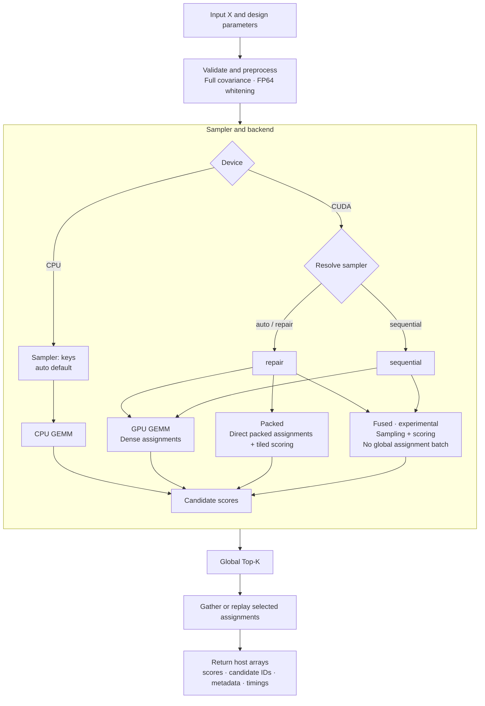
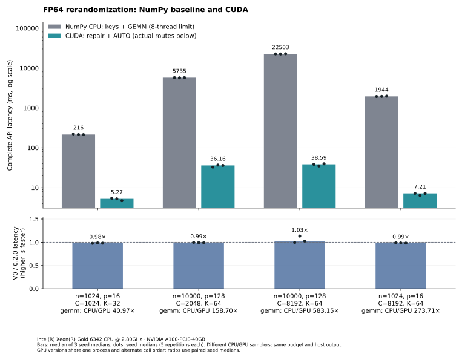

# FlashRerand

## Overview

GPU-accelerated rerandomization in Python. Generate a fixed budget of assignments,
each treating exactly `n1` units, and return the global best `k` by full-covariance
Mahalanobis balance: $M=\frac{n_1(n-n_1)}{n}\Delta^\top S^{-1}\Delta$ in FP64,
where $\Delta=\bar X_T-\bar X_C$ and $S$ is the sample covariance (`ddof=1`).
Lower is better; exact ties use candidate IDs. Set `k=1` for best-choice fixed-budget search.

FlashRerand provides three GPU execution paths: GEMM, Packed, and Fused. Its "Flash"
design emphasizes compact assignment storage, covariate-tile reuse, and fused
sampling and scoring. The Fused path avoids writing candidate assignment batches
to global memory and reconstructs only the selected results.

## Install

Python 3.10+. Install from this checkout; CUDA requires an NVIDIA GPU and CUDA 12.x.

```sh
python -m pip install .              # CPU: NumPy only
python -m pip install ".[cuda12]"     # GPU: CuPy 13.6.0
```

## Example

```python
import numpy as np
from flashrerand import rerandomize

X = np.random.default_rng(2026).normal(size=(1024, 16))
result = rerandomize(
    X, n1=512, candidates=8192, k=64, seed=42, batch_size=2048,
    device="cuda", sampler="auto", backend="auto",
)
print(result.assignments.shape)       # (64, 1024); each row treats 512 units
print(result.scores[:5], result.candidate_ids[:5])
print(result.metadata["execution"])  # Actual routes, policy and hardware
```

Use `device="cpu"` for CPU execution, `k=1` for one result, or `backend="packed"`
to force Packed on CUDA. Results include host NumPy arrays, metadata and timings.

| Device | Sampler | Backend |
|---|---|---|
| CPU | `auto`, `keys` | `auto`, `gemm` |
| CUDA | `auto`, `repair` | `auto`, `gemm`, `packed` |
| CUDA | `auto`, `repair` | `fused`: experimental; n ≤ 1024, p ≤ 32 |
| CUDA | `sequential` | `auto`, `gemm`; `fused`: experimental, p ≤ 1024 |

**In 0.2.0, backend AUTO conservatively uses GEMM everywhere.** Packed is available
by explicit override. Sampler AUTO means repair on CUDA and keys on CPU; backend
selection never changes it. CUDA `sampler="auto", backend="fused"` therefore uses
repair-fused. Unsupported combinations and unavailable CUDA raise errors.



Sampler nodes identify the selected strategy. Fused performs sampling inside its
scoring kernel: repair-fused keeps packed membership in shared memory, while
sequential-fused generates assignments on the fly. In 0.2.0, `backend="auto"`
selects GEMM without changing the sampler.

## Performance

CPU/GPU speedups range from 40.97× to 583.15× across these four measured tasks.



Measured calls include preprocessing and full host output. Hardware: Xeon Gold 6342
and A100-PCIE-40GB; batch size 2048. CPU uses keys + GEMM with an 8-thread limit;
GPU uses repair + AUTO/GEMM with a 1-thread host limit. Actual thread-pool metadata
is included where available. Equal seeds do not imply equal CPU/GPU candidate pools.

Seeds 42/43/44 each use 2 warmups and 5 measured calls. CPU/GPU blocks run serially
in alternating order. First calls are separate; shared libraries and disk caches
may already be warm. Bars show medians of seed medians; ratios use paired seed
medians. [Raw timings and environment](assets/benchmark.json).

## Tests and reproduction

Independent CPU score checks use `atol=1e-10, rtol=1e-11`. Tests cover fixed counts,
replay, backend selection and bounded full pools; benchmarks validate selected outputs.

```sh
python -m unittest discover -s tests -v
FLASHRERAND_REQUIRE_CUDA=1 python -m unittest discover -s tests -v
python -m pip install ".[benchmark]"  # Optional Matplotlib
python benchmark.py run --output results/benchmark.json
python benchmark.py plot results/benchmark.json --cpu-gpu-only --output results/performance.svg
```

Use `--smoke --cpu-only` for a small CPU trial. Choose new output paths;
existing results are not overwritten. Keep `.private.log` diagnostics private.

## Notes and license

Inputs must be finite and full rank after centering: `1 <= p < n-1`, `1 <= n1 < n`,
`1 <= k <= candidates`. Constant columns and covariance condition numbers above
`1e10` are rejected; no ridge is added. Repeated assignments are allowed. Repair
routes share candidate addresses; close floating-point rankings can still differ.
Sequential uses another candidate stream. One CUDA device is used per call;
internal module APIs are unstable. [MIT License](LICENSE).
